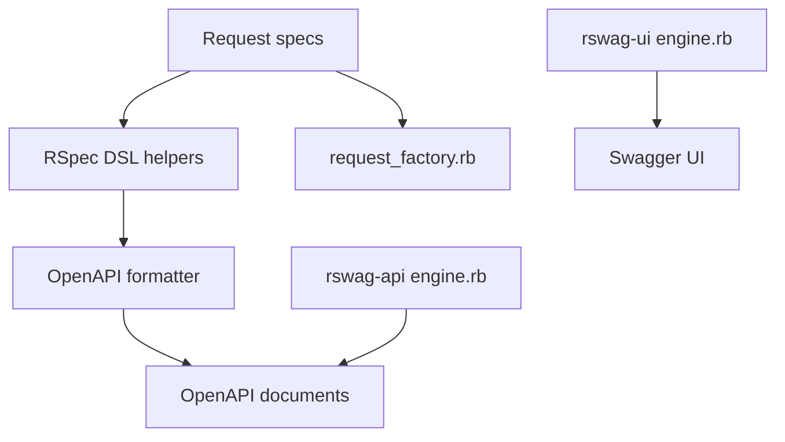

# rswag/rswag

> Generates OpenAPI documentation for a Rails API from its RSpec tests, with Swagger UI built in.

## The problem
API documentation drifts out of sync with the code when it is written separately from the tests.

## What it actually does
Extends rspec-rails request specs with a Swagger DSL: you describe paths, parameters and responses, the tests validate responses against the schema, then a rake task produces OpenAPI 3 files in JSON or YAML. Three gems: rswag-specs, rswag-api (serves the files) and rswag-ui (embedded Swagger UI).

## How it is wired


## Trying it
```bash
bundle
rails g rswag:install
rake rswag:specs:swaggerize
```

## Cost and gotchas
Free. Rails and RSpec only. JSON Schema Draft4 validation (nullable via `nullable` or `x-nullable`). The README is looking for maintainers.

## What it is not
Not a language-independent tool: it does not document a non-Rails API.

## Alternatives
No alternative named in the README (swagger-codegen cited for generating clients).

## For you
Ignore: only useful for a Rails API, outside your usual data/AI/MLOps stack.
