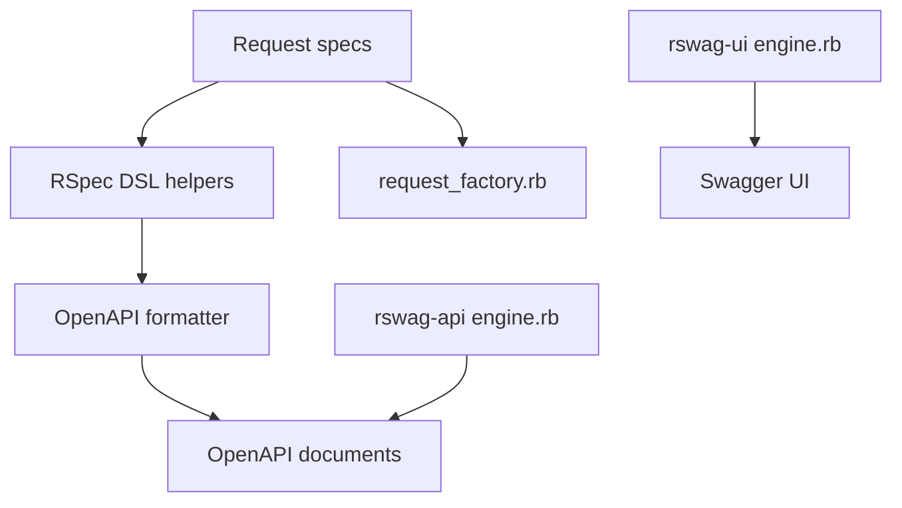

# rswag/rswag

> Génère la documentation OpenAPI d'une API Rails à partir de ses tests RSpec, avec Swagger UI intégrée.

## Le problème
La documentation d'API se désynchronise du code quand elle est écrite à part des tests.

## Ce que ça fait vraiment
Étend les request specs rspec-rails avec un DSL Swagger : on décrit chemins, paramètres et réponses, les tests valident les réponses contre le schéma, puis une tâche rake produit des fichiers OpenAPI 3 en JSON ou YAML. Trois gems : rswag-specs, rswag-api (expose les fichiers) et rswag-ui (Swagger UI embarquée).

## Comment c'est branché


## Essayer
```bash
bundle
rails g rswag:install
rake rswag:specs:swaggerize
```

## Coût et pièges
Gratuit. Réservé à Rails et RSpec. Validation JSON Schema Draft4 (nullable via `nullable` ou `x-nullable`). Le README cherche des mainteneurs.

## Ce que ce n'est pas
Pas un outil indépendant du langage : il ne documente pas une API non Rails.

## Alternatives
Aucune alternative nommée dans le README (swagger-codegen cité pour générer des clients).

## Pour toi
À ignorer : utile seulement pour une API Rails, hors de ta pile data/IA/MLOps habituelle.

