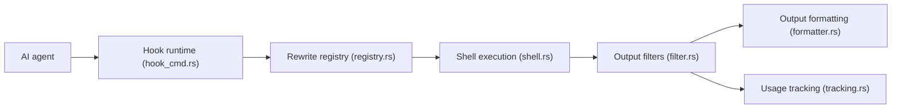

# rtk-ai/rtk

> A Rust-based binary that compresses the output of shell commands before a code agent reads it.

## The problem
Frequent use of Git, Docker, or other tools that involve extensive output can consume the context and tokens of the agent.

## What it actually does
A hook rewrites commands (e.g., `git status`) to `rtk git status`, which filters, groups, truncates, and deduplicates the output: covering over 100 commands. `rtk gain` measures savings (estimated at bytes/4). An optional proxy (BUSL-1.1) compresses API traffic; a `pipeline.toml`-driven engine is also provided. The hook only applies to Bash commands, not to tools like Read/Grep/Glob.

## How it is wired


## Trying it
```bash
brew install rtk
rtk --version
rtk gain
rtk init -g
rtk gain --graph
```

## Cost and gotchas
Free to produce, but with a mixed license: the `rtk` edition contains BUSL-1.1 (the engine); `rtk-oss` is Apache-2.0 only. Reselling RTK as a service is not permitted. Another project with the same name is available on crates.io: check with `rtk gain`. Telemetry is disabled by default.

## What it is not
Do not reduce the cost in the same proportion: only the Bash command is compressed. Do not use the agent's built-in tools.

## Alternatives
- RTK-OSS version: same hook and filters, without the BUSL engine.

## For you
Recommended: A measurable gain in context with minimal adjustments; if the BUSL license is a concern, choose the OSS version.
