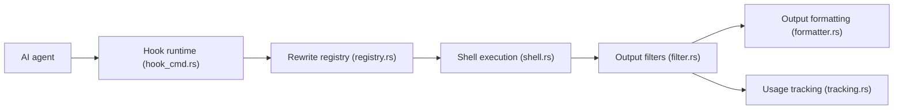

# rtk-ai/rtk

> Binaire Rust qui compresse la sortie des commandes shell avant qu'un agent de code ne la lise.

## Le problème
Les sorties verbeuses de git, tests ou docker consomment le contexte et les tokens de l'agent.

## Ce que ça fait vraiment
Un hook réécrit les commandes (par exemple `git status`) vers `rtk git status`, qui filtre, groupe, tronque et dédoublonne la sortie : plus de 100 commandes couvertes. `rtk gain` mesure les économies (estimées à bytes/4). Un proxy optionnel (BUSL-1.1) compresse le trafic API ; un moteur pilotable par `pipeline.toml` est aussi fourni. Le hook ne s'applique qu'aux appels Bash, pas aux outils Read/Grep/Glob.

## Comment c'est branché


## Essayer
```bash
brew install rtk
rtk --version
rtk gain
rtk init -g
rtk gain --graph
```

## Coût et pièges
Gratuit en production, mais licence mixte : l'édition `rtk` contient du BUSL-1.1 (moteur) ; `rtk-oss` est Apache-2.0 seul. Revendre RTK comme service est exclu. Autre projet homonyme sur crates.io : vérifier avec `rtk gain`. Télémétrie désactivée par défaut.

## Ce que ce n'est pas
Ne réduit pas la facture dans la même proportion : seule la sortie bash est compressée. Ne passe pas par les outils intégrés de l'agent.

## Alternatives
- Édition rtk-oss : même hook et filtres, sans moteur BUSL.

## Pour toi
À adopter : un gain de contexte mesurable pour peu de réglages ; choisis l'édition oss si la licence BUSL te gêne.

