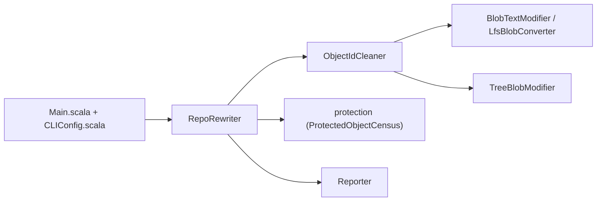

# rtyley/bfg-repo-cleaner

> Scala command-line tool that purges large blobs and secrets from a Git repository.

## The problem
A committed password or huge file stays in the Git history. `git-filter-branch` removes it, but slowly.

## What it actually does
Rewrites the history of a local repository: removes blobs larger than a given size, replaces texts listed in a file (passwords, credentials). The engine reads the Git objects, transforms the targeted blobs and trees, then writes the rewritten objects. Protected objects (current refs) are identified and flagged. Also handles LFS conversion.

## How it is wired


## Trying it
```bash
bfg --strip-blobs-bigger-than 1M --replace-text banned.txt repo.git
```

## Cost and gotchas
Free. It needs a JVM (written in Scala, sbt build). Rewriting history is destructive: work on a mirror clone.

## What it is not
Not a secret detector: you must give it what to erase. Does not revoke a secret that has already leaked. Last push in January 2025.

## Alternatives
- `git-filter-branch`: the native tool that BFG replaces, slower.

## For you
Worth keeping at hand to clean an ML repository that embedded a dataset or a key, but keep an eye on it: GPL-3.0, a single maintainer and no push for almost two years.
