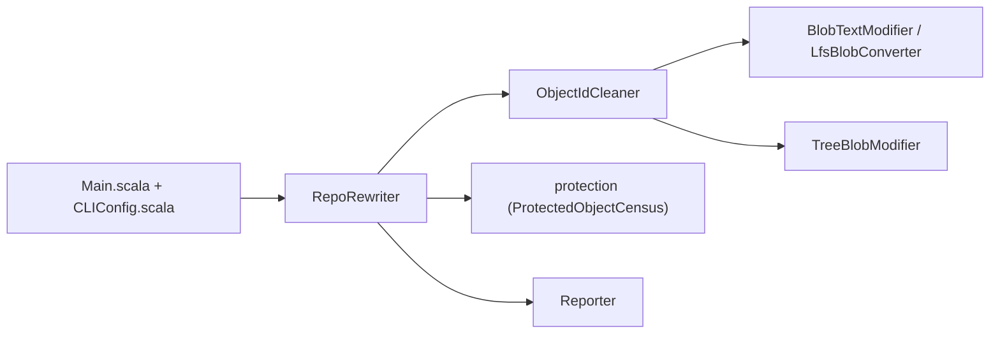

# rtyley/bfg-repo-cleaner

> Outil Scala en ligne de commande qui purge d'un dépôt Git les gros blobs et les secrets.

## Le problème
Un mot de passe ou un fichier énorme committé reste dans l'historique Git. `git-filter-branch` le retire, mais lentement.

## Ce que ça fait vraiment
Réécrit l'historique d'un dépôt local : supprime les blobs plus gros qu'une taille donnée, remplace des textes listés dans un fichier (mots de passe, identifiants). Le moteur lit les objets Git, transforme les blobs et arbres ciblés, puis écrit les objets réécrits. Les objets protégés (refs courantes) sont distingués et signalés. Gère aussi la conversion LFS.

## Comment c'est branché


## Essayer
```bash
bfg --strip-blobs-bigger-than 1M --replace-text banned.txt repo.git
```

## Coût et pièges
Gratuit. Il faut une JVM (écrit en Scala, build sbt). Réécrire l'historique est destructif : travailler sur un clone miroir.

## Ce que ce n'est pas
Pas un détecteur de secrets : il faut lui fournir ce qu'il doit effacer. Ne révoque pas un secret déjà fuité. Dernier push en janvier 2025.

## Alternatives
- `git-filter-branch` : l'outil natif que BFG remplace, plus lent.

## Pour toi
À garder sous la main pour nettoyer un dépôt ML qui a embarqué un dataset ou une clé, mais surveiller : GPL-3.0, un seul mainteneur et pas de push depuis près de deux ans.

