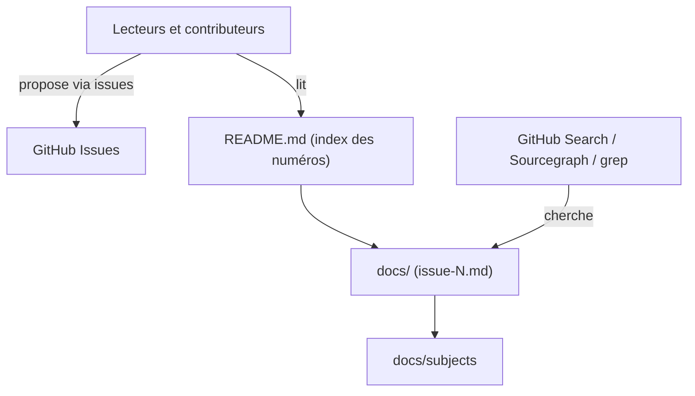

# ruanyf/weekly

> A weekly Chinese-language newsletter on technology and digital culture, published every Friday, for Chinese-speaking readers.

## The problem
Sorting out each week what is worth reading in tech takes time. This newsletter does the selection, in Chinese.

## What it actually does
The repository stores the issues (from the 1st to the 418th) as markdown files in `docs/`, with an index by year and by month. A `docs/subjects` folder groups topics. Readers suggest texts or tools through issues. Search goes through GitHub, Sourcegraph or grep.

## How it is wired

## Trying it
No command documented in the provided README: you read the issues on GitHub.

## Cost and gotchas
Free. The content is in Chinese, with no translation. Over 10,000 open issues: the repository also serves as a suggestion feed.

## What it is not
Not an RSS feed or a tool: it is a text archive. No license is declared, so there is no explicit right of reuse.

## Alternatives
No alternative named in the README.

## For you
Worth watching only if you read Chinese: good general watch on AI and software, with no value for your tooling.
