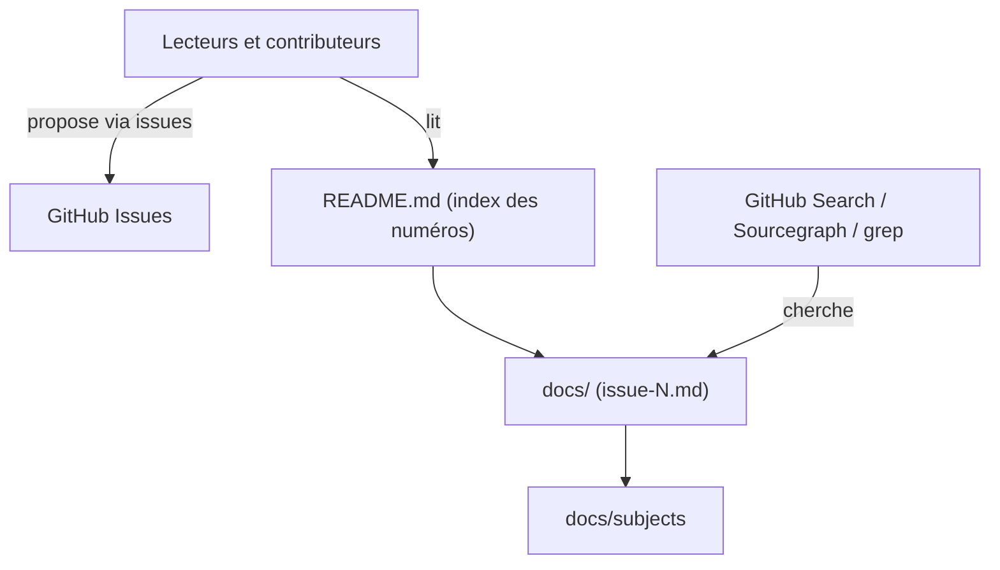

# ruanyf/weekly

> Newsletter hebdomadaire chinoise de technologie et de culture numérique, publiée chaque vendredi, pour lecteurs sinophones.

## Le problème
Trier chaque semaine ce qui mérite d'être lu dans la tech demande du temps. Cette lettre fait la sélection, en chinois.

## Ce que ça fait vraiment
Le dépôt stocke les numéros (de la 1re à la 418e période) sous forme de fichiers markdown dans `docs/`, avec un index par année et par mois. Un dossier `docs/subjects` regroupe des sujets. Les lecteurs proposent des textes ou des outils via les issues. La recherche passe par GitHub, Sourcegraph ou grep.

## Comment c'est branché

## Essayer
Aucune commande documentée dans le README fourni : on lit les numéros sur GitHub.

## Coût et pièges
Gratuit. Le contenu est en chinois, sans traduction. Plus de 10 000 issues ouvertes : le dépôt sert aussi de fil de suggestions.

## Ce que ce n'est pas
Pas un flux RSS ni un outil : c'est une archive de texte. Aucune licence n'est déclarée, donc pas de droit de réutilisation explicite.

## Alternatives
Aucune alternative nommée dans le README.

## Pour toi
À surveiller seulement si tu lis le chinois : bonne veille générale sur l'IA et le logiciel, sans valeur pour ton outillage.

