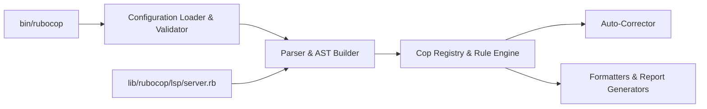

# rubocop/rubocop

> Static analyzer and formatter for Ruby code that enforces the community style guide.

## The problem
Ruby code without shared rules degrades and reviews waste time on style.

## What it actually does
It parses each file into an AST, applies "cops" (one rule per class), collects the offenses, automatically fixes some of them, then sends them to a formatter. A cache skips unchanged files; a persistent server and an LSP server exist for editors. Plugins add cops. Everything is configured through YAML files.

## How it is wired


## Trying it
```bash
gem install rubocop
cd my/cool/ruby/project
rubocop
```

## Cost and gotchas
Free. The project seeks funding (Open Collective, GitHub Sponsors, Tidelift). The logo is under a non-commercial license, separate from the code.

## What it is not
Not a security tool nor a performance analysis tool. It targets Ruby only.

## Alternatives
No alternative named in the README.

## For you
Keep an eye on it: essential if you write Ruby; otherwise irrelevant in a data/AI context, which is mostly Python.
