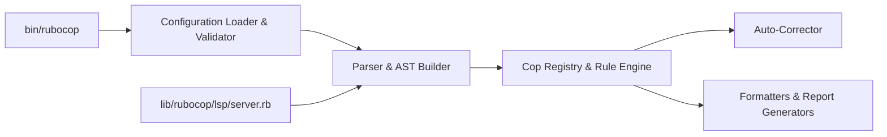

# rubocop/rubocop

> Analyseur statique et formateur de code Ruby qui applique le guide de style de la communauté.

## Le problème
Un code Ruby sans règles communes se dégrade et les revues perdent du temps sur le style.

## Ce que ça fait vraiment
Il parse chaque fichier en AST, applique des « cops » (une règle par classe), collecte les infractions, corrige automatiquement une partie, puis les envoie à un formateur. Un cache saute les fichiers inchangés ; un serveur persistant et un serveur LSP existent pour les éditeurs. Les plugins ajoutent des cops. Tout se règle par fichiers YAML.

## Comment c'est branché


## Essayer
```bash
gem install rubocop
cd my/cool/ruby/project
rubocop
```

## Coût et pièges
Gratuit. Le projet cherche du financement (Open Collective, GitHub Sponsors, Tidelift). Le logo est sous licence non commerciale, distincte du code.

## Ce que ce n'est pas
Pas un outil de sécurité ni d'analyse de performance. Il cible Ruby seulement.

## Alternatives
Aucune alternative nommée dans le README.

## Pour toi
À surveiller : essentiel si tu écris du Ruby ; sinon sans objet dans un contexte data/IA, surtout Python.

