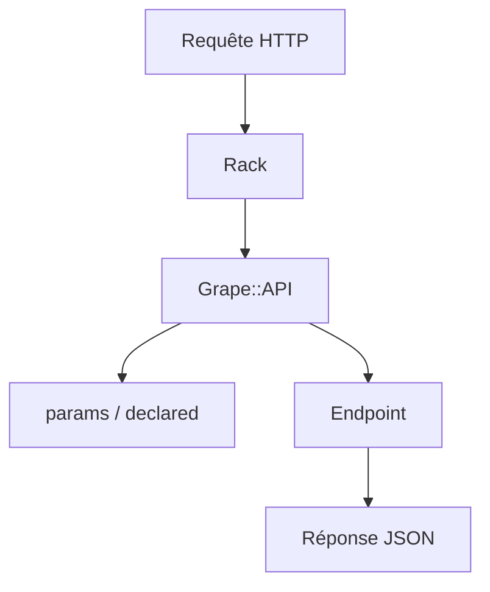

# ruby-grape/grape

> Ruby framework for writing REST APIs on Rack, standalone or alongside Rails and Sinatra.

## The problem
Writing clean REST APIs (versions, validated parameters, formats) with a full web framework is heavy.

## What it actually does
A DSL to declare routes, typed parameters (requires/optional), versions (path, header, parameter), content negotiation and error handling. An API mounts in Rack, Rails or behind Rack::Cascade with Sinatra. Method descriptions feed grape-swagger.

## How it is wired
Simplified diagram based on the sheet, no diagram provided.



## Trying it
```bash
bundle add grape
rackup
curl http://localhost:9292/v1/statuses/public_timeline
```

## Cost and gotchas
Free. Ruby 3.3.1 or later is required. Routes are compiled on the first request, unless `compile!` is called. The README gives contradictory stable versions (4.2.0 and 4.1.0).

## What it is not
Not a full web framework: no views, no ORM. The `desc` block is only for documentation and does not change behavior.

## Alternatives
No alternative named in the README (Rails and Sinatra are companions, not replacements).

## For you
Ignore: Ruby framework; to serve a model as an API, FastAPI or a Python equivalent is more natural, but not cited here.
