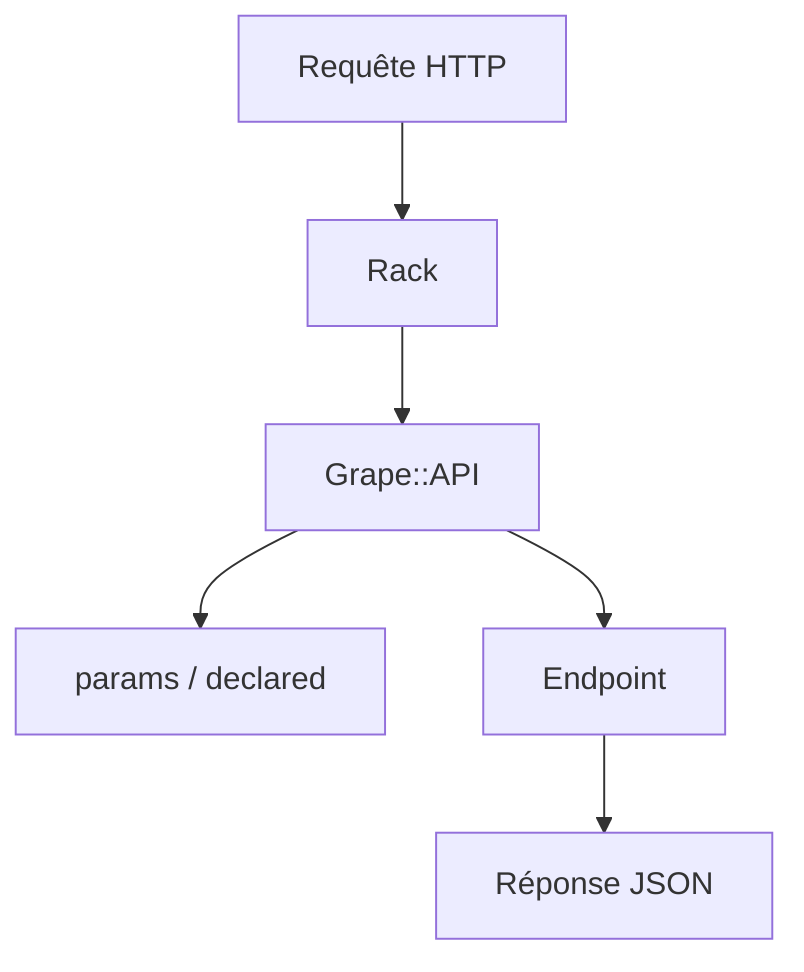

# ruby-grape/grape

> Framework Ruby pour écrire des API REST sur Rack, seul ou à côté de Rails et Sinatra.

## Le problème
Écrire des API REST propres (versions, paramètres validés, formats) avec un framework web complet est lourd.

## Ce que ça fait vraiment
Un DSL pour déclarer routes, paramètres typés (requires/optional), versions (chemin, en-tête, paramètre), négociation de contenu et gestion d'erreurs. Une API se monte dans Rack, Rails ou derrière Rack::Cascade avec Sinatra. Des descriptions de méthodes alimentent grape-swagger.

## Comment c'est branché
Schéma simplifié d'après la fiche, sans diagramme fourni.



## Essayer
```bash
bundle add grape
rackup
curl http://localhost:9292/v1/statuses/public_timeline
```

## Coût et pièges
Gratuit. Ruby 3.3.1 ou plus est requis. Les routes sont compilées à la première requête, sauf appel à `compile!`. Le README donne des versions stables contradictoires (4.2.0 et 4.1.0).

## Ce que ce n'est pas
Pas un framework web complet : pas de vues, ni d'ORM. Le bloc `desc` ne sert qu'à la documentation et ne change pas le comportement.

## Alternatives
Aucune alternative nommée dans le README (Rails et Sinatra sont des compagnons, pas des remplaçants).

## Pour toi
À ignorer : framework Ruby ; pour servir un modèle en API, FastAPI ou équivalent Python est plus naturel, mais non cité ici.

