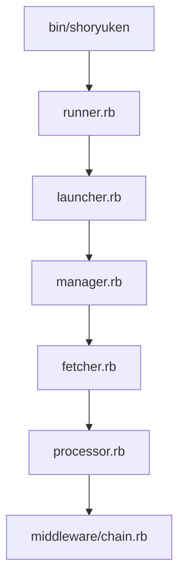

# ruby-shoryuken/shoryuken

> Threaded Amazon SQS message processor for Ruby, for Rails applications and ActiveJob jobs.

## The problem
Consuming SQS queues requires handling long polling, concurrency, visibility timeouts and retries.

## What it actually does
Provides a launcher, a manager, a fetcher and a threaded processor with weighted load balancing, per-queue concurrency, batch processing, automatic visibility timeout extension, exponential backoff and middlewares (automatic deletion). Rails ActiveJob adapter and `shoryuken help sqs` CLI.

## How it is wired


## Trying it
```bash
bundle
bundle exec rake spec
docker compose up -d
bundle exec rake spec:integration
```

## Cost and gotchas
Free, but you need an AWS account and SQS queues billed on usage. Ruby 3.3 or later. LGPL-3.0 license (copyleft). Integration tests use ElasticMQ.

## What it is not
Not a broker: it consumes SQS. Not an equivalent of Sidekiq (which relies on Redis), from which it takes inspiration.

## Alternatives
Sidekiq: the project Shoryuken is inspired by, based on Redis rather than SQS.

## For you
Ignore: it serves Ruby apps on SQS, outside your data/AI/MLOps stack.
