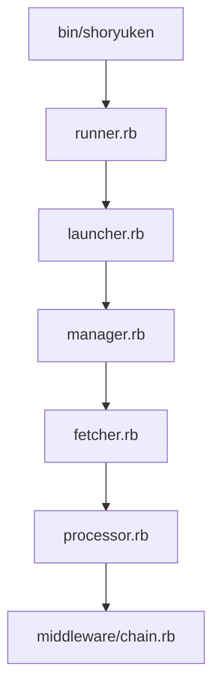

# ruby-shoryuken/shoryuken

> Processeur de messages Amazon SQS à threads pour Ruby, pour applications Rails et jobs ActiveJob.

## Le problème
Consommer des files SQS demande de gérer l'interrogation longue, la concurrence, les délais de visibilité et les reprises.

## Ce que ça fait vraiment
Fournit un lanceur, un gestionnaire, un récupérateur et un processeur à threads avec équilibrage de charge pondéré, concurrence par file, traitement par lots, prolongation automatique du délai de visibilité, backoff exponentiel et middlewares (suppression automatique). Adaptateur Rails ActiveJob et CLI `shoryuken help sqs`.

## Comment c'est branché


## Essayer
```bash
bundle
bundle exec rake spec
docker compose up -d
bundle exec rake spec:integration
```

## Coût et pièges
Gratuit, mais il faut un compte AWS et des files SQS facturés à l'usage. Ruby 3.3 ou plus. Licence LGPL-3.0 (copyleft). Les tests d'intégration utilisent ElasticMQ.

## Ce que ce n'est pas
Pas un broker : il consomme SQS. Pas un équivalent de Sidekiq (qui repose sur Redis), dont il s'inspire.

## Alternatives
Sidekiq : le projet dont s'inspire Shoryuken, basé sur Redis plutôt que sur SQS.

## Pour toi
À ignorer : sert aux apps Ruby sur SQS, hors de ta pile data/IA/MLOps.

