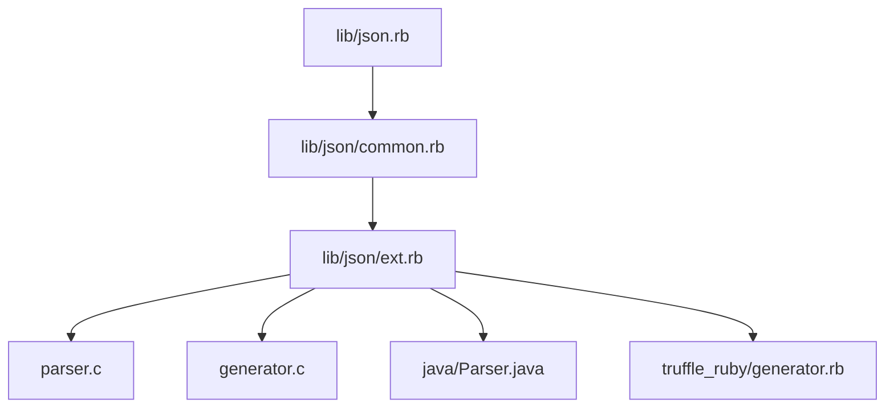

# ruby/json

> Ruby implementation of the JSON specification (RFC 7159), for anyone serializing or reading JSON in Ruby.

## The problem
Ruby needs a fast, compliant JSON reader and generator.

## What it actually does
`JSON.parse` and `JSON.generate`, with `pretty_generate`, a `JSON::Coder` API to serialize non-native types and `JSON::Fragment` to assemble pieces. MRI uses C extensions with SIMD, JRuby uses Java classes and TruffleRuby a generator written in Ruby.

## How it is wired


## Trying it
```bash
bundle add json
gem install json
bundle exec rake test
```

## Cost and gotchas
Free. Never let the user control the parsing or generation options: `JSON.generate(params[:data], params[:options])` is flagged as dangerous. License present but not identified by GitHub: to be checked.

## What it is not
Not a tool for another language: it is Ruby's standard JSON library.

## Alternatives
No alternative cited in the README.

## For you
Ignore: Ruby library shipped with the language, no stakes for a Python data, AI or MLOps profile.
