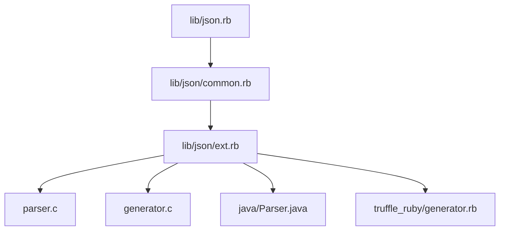

# ruby/json

> Implémentation Ruby de la spécification JSON (RFC 7159), pour qui sérialise ou lit du JSON en Ruby.

## Le problème
Ruby a besoin d'un lecteur et d'un générateur JSON rapides et conformes.

## Ce que ça fait vraiment
`JSON.parse` et `JSON.generate`, avec `pretty_generate`, une API `JSON::Coder` pour sérialiser des types non natifs et `JSON::Fragment` pour assembler des morceaux. MRI utilise des extensions C avec SIMD, JRuby des classes Java et TruffleRuby un générateur en Ruby.

## Comment c'est branché


## Essayer
```bash
bundle add json
gem install json
bundle exec rake test
```

## Coût et pièges
Gratuit. Ne jamais laisser l'utilisateur contrôler les options d'analyse ou de génération : `JSON.generate(params[:data], params[:options])` est signalé comme dangereux. Licence présente mais non identifiée par GitHub : à vérifier.

## Ce que ce n'est pas
Pas un outil pour une autre langue : c'est la bibliothèque standard JSON de Ruby.

## Alternatives
Aucune alternative citée dans le README.

## Pour toi
Ignorer : bibliothèque Ruby fournie avec le langage, sans enjeu pour un profil data, IA ou MLOps en Python.

