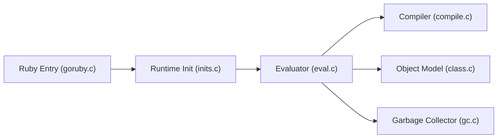

# ruby/ruby

> Source code of Ruby, an interpreted object-oriented language, often used for the web and scripting.

## The problem
A simple, extensible language for web development and system automation.

## What it actually does
Interpreter with simple syntax, objects, mix-ins, iterators and closures, exception handling, garbage collection, dynamic object loading. Based on the code: entry point, evaluator, compiler, object model, GC, fibers, I/O, plus RubyGems and Bundler. The README points to the documents for the build.

## How it is wired


## Trying it
```bash
git clone https://github.com/ruby/ruby.git
```
To compile, see "Building Ruby" (outside the README).

## Cost and gotchas
Free. License "present but unidentified" on the GitHub side; the README points to the COPYING file.

## What it is not
Not a ready-to-use distribution: to install, go through ruby-lang.org or a version manager.

## Alternatives
No alternative named in the README.

## For you
Outside your Python/ML ecosystem; with no need related to Rails or Ruby scripts, ignore.
