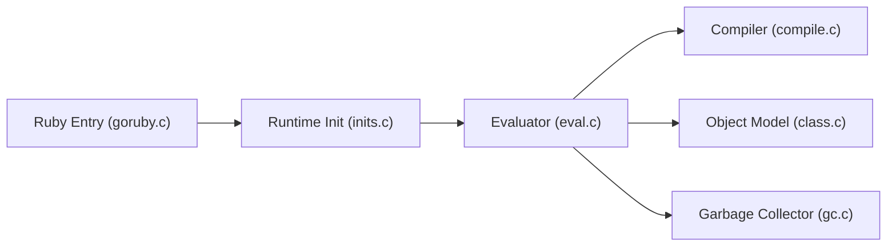

# ruby/ruby

> Code source de Ruby, langage interprété orienté objet, souvent utilisé pour le web et les scripts.

## Le problème
Un langage simple et extensible pour le développement web et l'automatisation système.

## Ce que ça fait vraiment
Interpréteur avec syntaxe simple, objets, mix-ins, itérateurs et fermetures, gestion d'exceptions, ramasse-miettes, chargement dynamique d'objets. D'après le code : point d'entrée, évaluateur, compilateur, modèle objet, GC, fibres, E/S, plus RubyGems et Bundler. Le README renvoie aux documents pour le build.

## Comment c'est branché


## Essayer
```bash
git clone https://github.com/ruby/ruby.git
```
Pour compiler, voir « Building Ruby » (hors README).

## Coût et pièges
Gratuit. Licence « présente mais non identifiée » côté GitHub ; le README renvoie au fichier COPYING.

## Ce que ce n'est pas
Pas une distribution prête à l'emploi : pour installer, passer par ruby-lang.org ou un gestionnaire de versions.

## Alternatives
Aucune alternative nommée dans le README.

## Pour toi
Hors de ton écosystème Python/ML ; sans besoin lié à Rails ou aux scripts Ruby, à ignorer.

