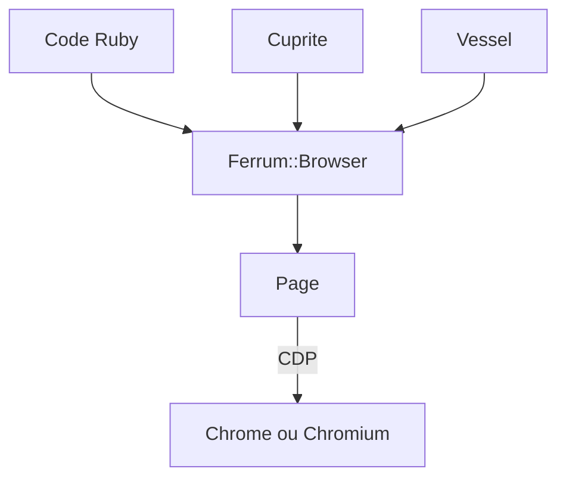

# rubycdp/ferrum

> High-level Ruby API to drive Chrome or Chromium via the CDP protocol, without Selenium.

## The problem
Automating Chrome in Ruby through WebDriver is limited and depends on an external driver.

## What it actually does
It connects directly to Chrome over CDP, headless by default. Navigation, screenshots, JavaScript evaluation, mouse, keyboard. Cuprite (Capybara driver) and Vessel (crawling) build on it.

## How it is wired
Simplified diagram based on the sheet, no diagram provided.



## Trying it
```bash
bundle install
docker run --rm -p 3000:3000 ghcr.io/rubycdp/chromium
bundle exec rake test
```

## Cost and gotchas
Free; you need official Chrome or Chromium in the PATH or via `BROWSER_PATH`, or the provided Docker image.

## What it is not
Not a multi-browser tool: Chrome only. Ruby only.

## Alternatives
Selenium/WebDriver, mentioned as what Ferrum does without.

## For you
Ignore if you work in Python: scraping and browser testing are done elsewhere, this library is Ruby.
