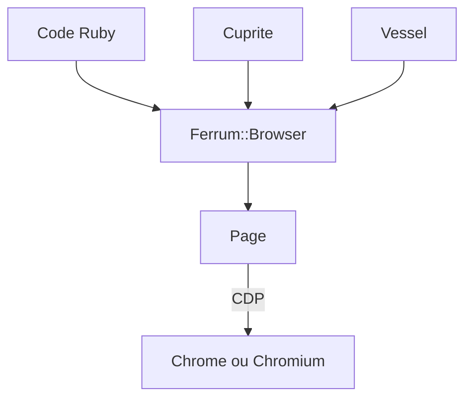

# rubycdp/ferrum

> API Ruby de haut niveau pour piloter Chrome ou Chromium via le protocole CDP, sans Selenium.

## Le problème
Automatiser Chrome en Ruby via WebDriver est limité et dépend d'un pilote externe.

## Ce que ça fait vraiment
Elle se connecte directement à Chrome en CDP, headless par défaut. Navigation, captures d'écran, évaluation de JavaScript, souris, clavier. Cuprite (pilote Capybara) et Vessel (crawling) s'appuient dessus.

## Comment c'est branché
Schéma simplifié d'après la fiche, sans diagramme fourni.



## Essayer
```bash
bundle install
docker run --rm -p 3000:3000 ghcr.io/rubycdp/chromium
bundle exec rake test
```

## Coût et pièges
Gratuit ; il faut Chrome ou Chromium officiel dans le PATH ou via `BROWSER_PATH`, ou l'image Docker fournie.

## Ce que ce n'est pas
Pas un outil multi-navigateurs : Chrome uniquement. Ruby uniquement.

## Alternatives
Selenium/WebDriver, mentionné comme ce dont Ferrum se passe.

## Pour toi
À ignorer si tu travailles en Python : le scraping et le test navigateur se font ailleurs, cette bibliothèque est Ruby.

