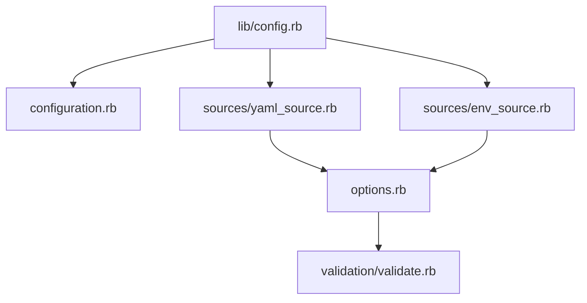

# rubyconfig/config

> Ruby gem that loads per-environment settings from YAML files, for Rails, Sinatra or Padrino applications.

## The problem
Settings vary by environment and by developer, and end up scattered across files, environment variables and secrets.

## What it actually does
Merges YAML sources (with ERB), environment variables and hashes into a `Settings` object accessible with dot notation. Per-environment files and git-ignored local files, hot reloading, sources added at runtime, optional validation (dry-schema, dry-validation), a `fail_on_missing` option, reading from AWS Secrets Manager via EnvSource.

## How it is wired


## Trying it
```bash
bundle install
rails g config:install
```
```ruby
Settings.my_section.some_entry
```

## Cost and gotchas
Free. Ruby 2.6 or later and Rails 5.2 or later; versions 1.x and 3.x target older versions. License present but not identified by GitHub. Environment variables do not work with arrays.

## What it is not
Not a secrets manager. `settings.local.yml` is not loaded during tests.

## Alternatives
AppConfig: to be used for very old versions of Ruby or Rails.

## For you
Ignore: configuration for Ruby applications; in Python you have native equivalents.
