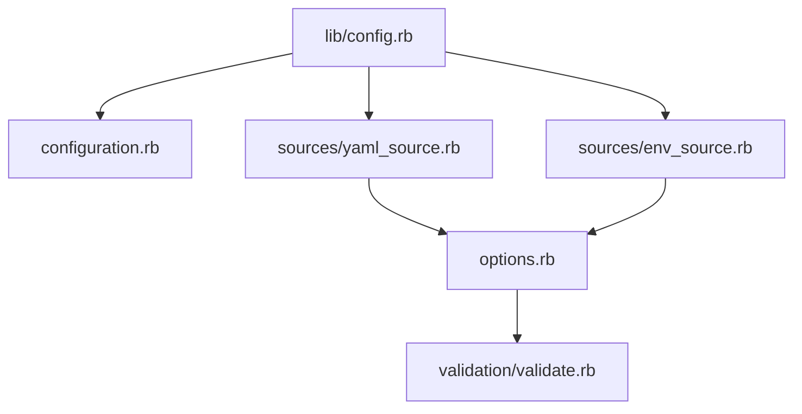

# rubyconfig/config

> Gem Ruby qui charge des réglages par environnement depuis des fichiers YAML, pour applications Rails, Sinatra ou Padrino.

## Le problème
Les réglages varient selon l'environnement et les développeurs, et finissent dispersés entre fichiers, variables d'environnement et secrets.

## Ce que ça fait vraiment
Fusionne des sources YAML (avec ERB), variables d'environnement et hashes en un objet `Settings` accessible par notation pointée. Fichiers par environnement et fichiers locaux ignorés par git, rechargement à chaud, sources ajoutées à l'exécution, validation optionnelle (dry-schema, dry-validation), option `fail_on_missing`, lecture d'AWS Secrets Manager via EnvSource.

## Comment c'est branché


## Essayer
```bash
bundle install
rails g config:install
```
```ruby
Settings.my_section.some_entry
```

## Coût et pièges
Gratuit. Ruby 2.6 ou plus et Rails 5.2 ou plus ; les versions 1.x et 3.x visent d'anciennes versions. Licence présente mais non identifiée par GitHub. Les variables d'environnement ne fonctionnent pas avec les tableaux.

## Ce que ce n'est pas
Pas un gestionnaire de secrets. `settings.local.yml` n'est pas chargé pendant les tests.

## Alternatives
AppConfig : à utiliser pour les très anciennes versions de Ruby ou de Rails.

## Pour toi
À ignorer : configuration d'applications Ruby ; en Python tu as des équivalents natifs.

