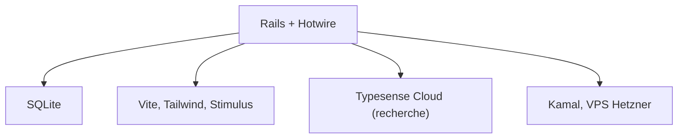

# rubyevents/rubyevents

> Site that catalogs Ruby conferences and videos from around the world, for the Ruby community.

## The problem
Ruby videos and events are scattered; there is no single index.

## What it actually does
Rails application (Hotwire, Solid Queue, Solid Cache) with Vite, Tailwind, daisyUI and Stimulus. SQLite as the database, deployed on a Hetzner VPS with Kamal. Search goes through Typesense Cloud.

## How it is wired
Simplified diagram based on the sheet, no diagram provided.


## Trying it
```bash
# Aucune commande documentée dans le README.
```

## Cost and gotchas
No installation described. Ruby and Rails are needed to run the code; search depends on Typesense Cloud. No license.

## What it is not
Not a tool to reuse: it is the code of one specific site.

## Alternatives
- pyvideo.org (cited as a source of inspiration).

## For you
Ignore: a Ruby directory unrelated to your field; at best an example of a Rails application.
