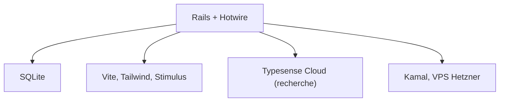

# rubyevents/rubyevents

> Site qui référence les conférences et vidéos Ruby du monde entier, pour la communauté Ruby.

## Le problème
Les vidéos et événements Ruby sont éparpillés ; il manque un index unique.

## Ce que ça fait vraiment
Application Rails (Hotwire, Solid Queue, Solid Cache) avec Vite, Tailwind, daisyUI et Stimulus. SQLite comme base, déploiement sur VPS Hetzner avec Kamal. La recherche passe par Typesense Cloud.

## Comment c'est branché
Schéma simplifié d'après la fiche, sans diagramme fourni.


## Essayer
```bash
# Aucune commande documentée dans le README.
```

## Coût et pièges
Pas d'installation décrite. Ruby et Rails nécessaires pour exécuter le code ; la recherche dépend de Typesense Cloud. Licence absente.

## Ce que ce n'est pas
Pas un outil à réutiliser : c'est le code d'un site précis.

## Alternatives
- pyvideo.org (cité comme source d'inspiration).

## Pour toi
À ignorer : annuaire Ruby sans lien avec ton métier ; au mieux un exemple d'application Rails.

