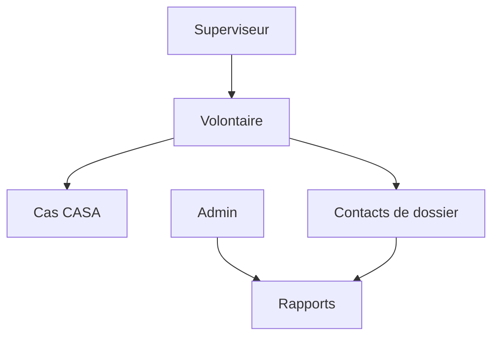

# rubyforgood/casa

> Rails application for tracking volunteers and cases for CASA organizations (children placed in foster care).

## The problem
CASA chapters enter volunteer data by hand into expensive software; their budget does not allow buying licenses so that volunteers can enter it themselves.

## What it actually does
A portal where volunteers log their activity (case contacts), where supervisors follow the volunteers, and where administrators generate reports for grant applications. Cases are assigned to volunteers. The application aims to be multi-chapter. Stack: Rails 7.2, PostgreSQL 14+, Hotwire, RSpec and StandardRB.

## How it is wired
Simplified diagram based on the sheet, no diagram provided.



## Trying it
```bash
git clone https://github.com/rubyforgood/casa.git
bin/setup
bin/dev
bin/rails spec
bin/lint
```

## Cost and gotchas
Free. You need Ruby (version from `.ruby-version`), Node LTS and PostgreSQL; none of these requirements is in the standard list. Test accounts and their passwords are public in the README, including on the QA environment.

## What it is not
Not a ready-to-use application for a chapter: it is a volunteer contribution project. Sign-up through the interface is deliberately absent.

## Alternatives
No alternative named in the README.

## For you
Ignore: a Rails business application with no link to data or AI, useful only as a volunteer project.
