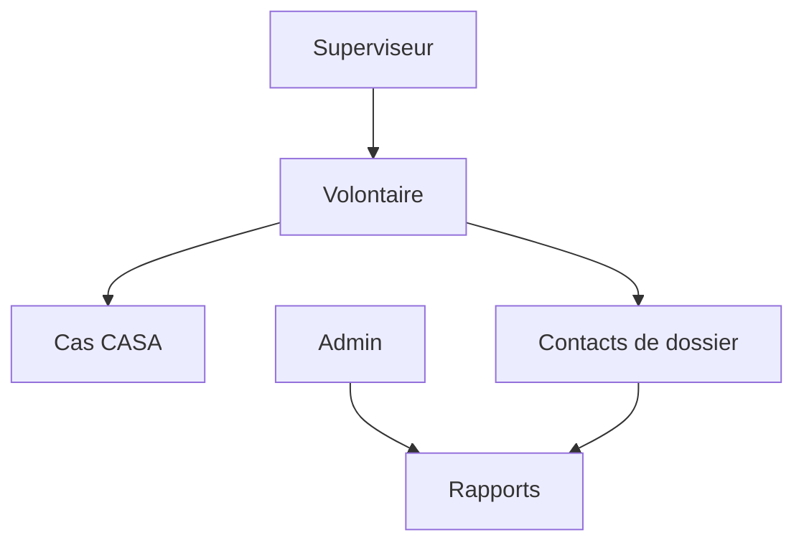

# rubyforgood/casa

> Application Rails de suivi des bénévoles et des dossiers pour les associations CASA (enfants placés en famille d'accueil).

## Le problème
Les antennes CASA saisissent à la main les données des bénévoles dans un logiciel coûteux ; leur budget ne permet pas d'acheter des licences pour que les bénévoles saisissent eux-mêmes.

## Ce que ça fait vraiment
Un portail où les bénévoles enregistrent leur activité (contacts de dossier), où les superviseurs suivent les bénévoles, et où les administrateurs génèrent des rapports pour des demandes de subvention. Les dossiers sont affectés aux bénévoles. L'application vise le multi-antenne. Stack : Rails 7.2, PostgreSQL 14+, Hotwire, RSpec et StandardRB.

## Comment c'est branché
Schéma simplifié d'après la fiche, sans diagramme fourni.



## Essayer
```bash
git clone https://github.com/rubyforgood/casa.git
bin/setup
bin/dev
bin/rails spec
bin/lint
```

## Coût et pièges
Gratuit. Il faut Ruby (version de `.ruby-version`), Node LTS et PostgreSQL ; aucun de ces besoins n'entre dans la liste standard. Les comptes de test et leurs mots de passe sont publics dans le README, y compris sur l'environnement QA.

## Ce que ce n'est pas
Pas une application prête à l'emploi pour une antenne : c'est un projet de contribution bénévole. L'inscription par l'interface est volontairement absente.

## Alternatives
Aucune alternative nommée dans le README.

## Pour toi
À ignorer : application métier Rails sans lien avec la data ou l'IA, utile seulement comme projet bénévole.

