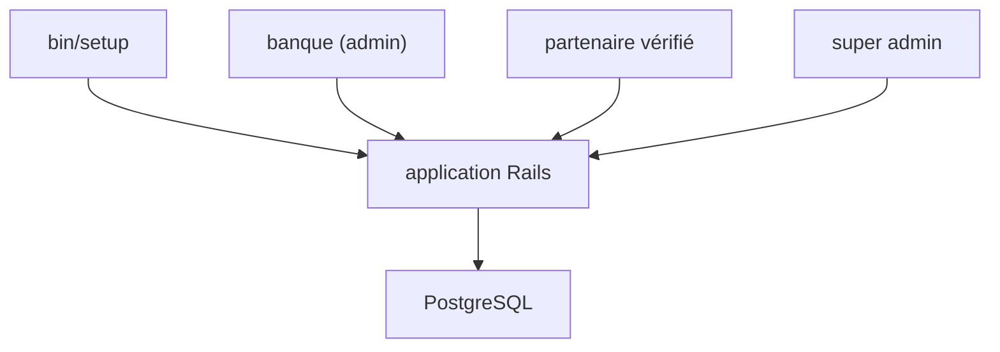

# rubyforgood/human-essentials

> Rails inventory management application for diaper banks and other essential-products banks.

## The problem
Essential-products banks manage donations, inventory and distributions to partners without a suitable tool.

## What it actually does
Manages inventory, donations and distributions to partner organizations, with reports, barcode readers, weighing and inventory audits. Free hosted service for more than 200 American banks; recognized as a digital public good. Built by Ruby for Good volunteers.

## How it is wired
Simplified diagram based on the sheet, no diagram provided.


## Trying it
```bash
bin/setup
bin/start
# puis http://localhost:3000/
```

## Cost and gotchas
Free. Real requirements: Ruby (version from `.ruby-version`) and PostgreSQL; Codespaces and Dev Container exist. Test passwords are published for staging.

## What it is not
It is not a generic enterprise inventory tool: it targets the model of essential-products banks.

## Alternatives
No alternative named in the README.

## For you
Ignore: a Rails line-of-business app for nonprofits, unrelated to data / AI, except for a volunteer project.
