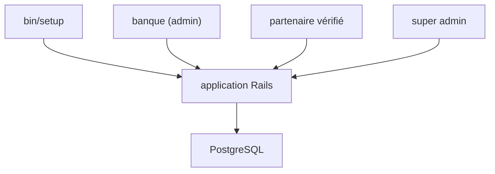

# rubyforgood/human-essentials

> Application Rails de gestion de stock pour banques de couches et d'autres banques de produits essentiels.

## Le problème
Les banques de produits essentiels gèrent dons, inventaire et distributions aux partenaires sans outil adapté.

## Ce que ça fait vraiment
Gère l'inventaire, les dons et les distributions vers des organisations partenaires, avec rapports, lecteurs de codes-barres, pesée et audits d'inventaire. Service hébergé gratuit pour plus de 200 banques américaines ; reconnu comme bien public numérique. Construit par des bénévoles de Ruby for Good.

## Comment c'est branché
Schéma simplifié d'après la fiche, sans diagramme fourni.


## Essayer
```bash
bin/setup
bin/start
# puis http://localhost:3000/
```

## Coût et pièges
Gratuit. Besoin réel : Ruby (version de `.ruby-version`) et PostgreSQL ; Codespaces et Dev Container existent. Mots de passe de test publiés pour le staging.

## Ce que ce n'est pas
Ce n'est pas un outil générique d'inventaire d'entreprise : il vise le modèle des banques de produits essentiels.

## Alternatives
Aucune alternative nommée dans le README.

## Pour toi
À ignorer : application métier associative en Rails, sans lien avec data / IA, sauf pour un projet bénévole.

