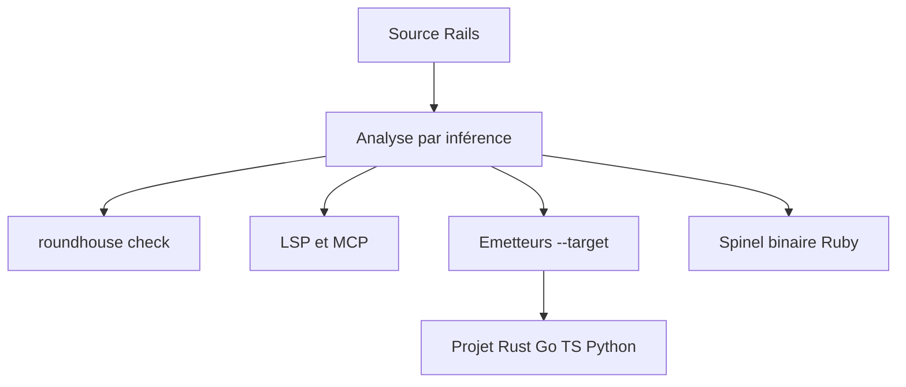

# rubys/roundhouse

> Static analysis of Rails applications and transpilation to Rust, Go, TypeScript, Python and other languages.

## The problem
A successful Rails application remains trapped in CRuby. Changing deployment target forces a rewrite.

## What it actually does
Reads Rails Ruby code without running it and infers types, associations and nil-safety. It provides `roundhouse check`, an LSP server, an MCP server and a browser IDE. It also emits standalone projects in about a dozen languages, validated against Rails by a conformance oracle. Ruby compiled to a binary via Spinel is a target.

## How it is wired
Simplified diagram based on the note, no diagram provided.



## Trying it
```bash
curl --proto '=https' --tlsv1.2 -LsSf \
  https://github.com/roundhouse-rb/roundhouse/releases/latest/download/roundhouse-installer.sh | sh
roundhouse --version
roundhouse check --continue /path/to/your/rails/app
cargo install --git https://github.com/roundhouse-rb/roundhouse --bin roundhouse
```

## Cost and gotchas
Free. Building from source: Rust toolchain. Binaries planned for macOS Apple silicon and Linux x86-64, Windows and Intel macOS untested. 251 open issues.

## What it is not
Not a ready-to-use production framework: Rails coverage remains partial. The throughput gains quoted come from a microbenchmark on a small fixture.

## Alternatives
- Sorbet and Steep: static typing but with annotations.
- ruby-lsp: static but goes no further than names.
- Juntos: transpiles Rails applications to JavaScript.

## For you
Worth watching: outside the data/AI scope, but the approach (inference without annotations, MCP for agents) is instructive if you have Rails.
