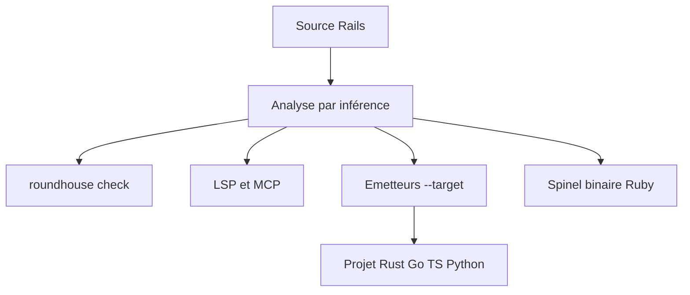

# rubys/roundhouse

> Analyse statique d'applications Rails et transpilation vers Rust, Go, TypeScript, Python et d'autres langages.

## Le problème
Une application Rails réussie reste prisonnière de CRuby. Changer de cible de déploiement impose une réécriture.

## Ce que ça fait vraiment
Lit le code Ruby de Rails sans l'exécuter et infère types, associations et nil-safety. Il fournit `roundhouse check`, un serveur LSP, un serveur MCP et un IDE navigateur. Il émet aussi des projets autonomes dans une douzaine de langages, validés contre Rails par un oracle de conformité. Ruby compilé en binaire via Spinel est une cible.

## Comment c'est branché
Schéma simplifié d'après la fiche, sans diagramme fourni.



## Essayer
```bash
curl --proto '=https' --tlsv1.2 -LsSf \
  https://github.com/roundhouse-rb/roundhouse/releases/latest/download/roundhouse-installer.sh | sh
roundhouse --version
roundhouse check --continue /path/to/your/rails/app
cargo install --git https://github.com/roundhouse-rb/roundhouse --bin roundhouse
```

## Coût et pièges
Gratuit. Compilation depuis les sources : toolchain Rust. Binaires prévus pour macOS Apple silicon et Linux x86-64, Windows et macOS Intel non testés. 251 issues ouvertes.

## Ce que ce n'est pas
Pas un framework de production prêt à l'emploi : la couverture de Rails reste partielle. Les gains de débit cités viennent d'un microbenchmark sur une petite fixture.

## Alternatives
- Sorbet et Steep : typage statique mais avec annotations.
- ruby-lsp : statique mais ne dépasse pas les noms.
- Juntos : transpile des applications Rails vers JavaScript.

## Pour toi
À surveiller : hors périmètre data/IA, mais l'approche (inférence sans annotation, MCP pour agent) est instructive si tu as du Rails.

