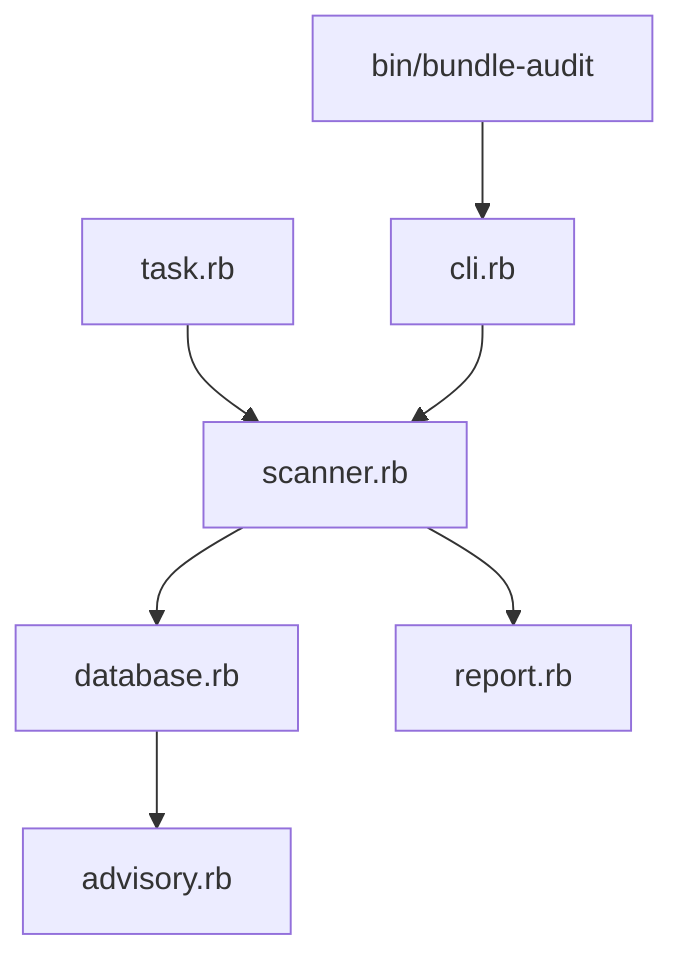

# rubysec/bundler-audit

> Command-line tool that checks a Gemfile.lock against a database of Ruby security advisories.

## The problem
A Ruby project can unknowingly ship vulnerable gems or insecure sources.

## What it actually does
Compares `Gemfile.lock` to the `ruby-advisory-db` database (local, refreshed by `update`), and also detects `http://` and `git://` sources. Lets you ignore advisories, outputs text or JSON, provides Rake tasks and a `.bundler-audit.yml` file. Works offline once the database is downloaded.

## How it is wired
Diagram based on the code diagram.



## Trying it
```bash
gem install bundler-audit
bundle-audit check --update
bundle-audit check --format json --output bundle-audit.json
```

## Cost and gotchas
Free, GPL-3.0 (copyleft). Ruby and git required. The advisory database must be updated regularly; the README also sets a strict policy on AI-generated contributions.

## What it is not
Not a code scanner: it only looks at declared gem versions.

## Alternatives
No alternative named in the README.

## For you
Ignore: reserved for Ruby projects, unless you want to copy the idea into a CI.
