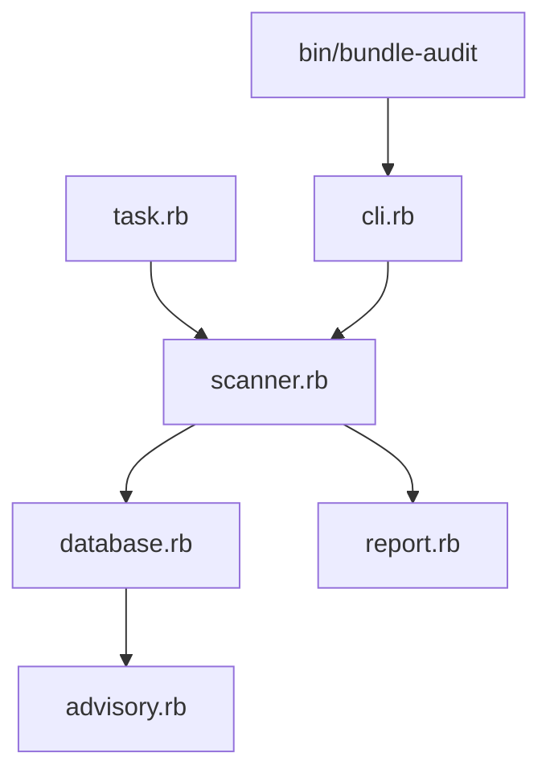

# rubysec/bundler-audit

> Outil en ligne de commande qui vérifie un Gemfile.lock contre une base d'avis de sécurité Ruby.

## Le problème
Un projet Ruby peut embarquer sans le savoir des gems vulnérables ou des sources non sécurisées.

## Ce que ça fait vraiment
Compare le `Gemfile.lock` à la base `ruby-advisory-db` (locale, mise à jour par `update`), détecte aussi les sources `http://` et `git://`. Permet d'ignorer des avis, sortie texte ou JSON, tâches Rake, fichier `.bundler-audit.yml`. Fonctionne sans réseau une fois la base téléchargée.

## Comment c'est branché
Schéma d'après le diagramme du code.



## Essayer
```bash
gem install bundler-audit
bundle-audit check --update
bundle-audit check --format json --output bundle-audit.json
```

## Coût et pièges
Gratuit, GPL-3.0 (copyleft). Ruby et git requis. La base d'avis doit être mise à jour régulièrement ; le README fixe aussi une politique stricte sur les contributions générées par IA.

## Ce que ce n'est pas
Pas un scanner de code : il ne regarde que les versions de gems déclarées.

## Alternatives
Aucune alternative nommée dans le README.

## Pour toi
À ignorer : réservé aux projets Ruby, sauf à vouloir copier l'idée dans une CI.

