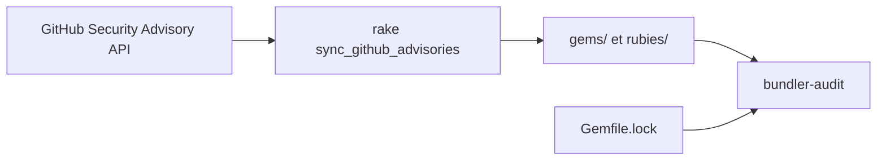

# rubysec/ruby-advisory-db

> Community database of security advisories for Ruby libraries and implementations.

## The problem
Knowing which gems or Ruby versions are vulnerable means following scattered sources.

## What it actually does
YAML files, organized by gem (`gems/`) and by implementation (`rubies/`), named by CVE or GHSA. Fields: gem, cve, ghsa, url, title, date, description, CVSS scores, patched versions. A rake script syncs from the GitHub Security Advisory API (token with no scope). Consumed by bundler-audit.

## How it is wired


## Trying it
```bash
bundle install
bundle exec rspec
GH_API_TOKEN="your GitHub API Token" bundle exec rake sync_github_advisories
```

## Cost and gotchas
Free, GitHub token required for syncing. No tracking of Rails LTS. Unreviewed AI contributions are rejected.

## What it is not
Not a scanner: it is the data; the analysis tool is bundler-audit. License not identified by GitHub.

## Alternatives
bundler-audit, cited in the README for checking your Gemfile.lock files.

## For you
Ignore: Ruby-specific, no use in a Python data/AI pipeline.
