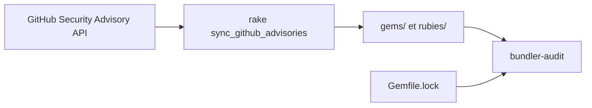

# rubysec/ruby-advisory-db

> Base communautaire d'avis de sécurité sur les bibliothèques et implémentations Ruby.

## Le problème
Savoir quelles gems ou versions de Ruby sont vulnérables demande de suivre des sources dispersées.

## Ce que ça fait vraiment
Des fichiers YAML, rangés par gem (`gems/`) et par implémentation (`rubies/`), nommés par CVE ou GHSA. Champs : gem, cve, ghsa, url, titre, date, description, scores CVSS, versions corrigées. Un script rake synchronise depuis l'API GitHub Security Advisory (token sans scope). Consommée par bundler-audit.

## Comment c'est branché


## Essayer
```bash
bundle install
bundle exec rspec
GH_API_TOKEN="your GitHub API Token" bundle exec rake sync_github_advisories
```

## Coût et pièges
Gratuit, token GitHub requis pour la synchronisation. Pas de suivi de Rails LTS. Contributions IA non relues rejetées.

## Ce que ce n'est pas
Pas un scanner : c'est la donnée ; l'outil d'analyse est bundler-audit. Licence non identifiée par GitHub.

## Alternatives
bundler-audit, cité dans le README pour vérifier ses Gemfile.lock.

## Pour toi
À ignorer : spécifique à Ruby, sans usage dans une chaîne data/IA en Python.

