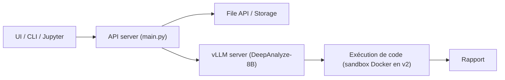

# ruc-datalab/DeepAnalyze

> 8B model and demo code to automate a data analysis all the way to the report.

## The problem
Chaining preparation, analysis, modeling, visualization and report writing on heterogeneous files is still manual.

## What it actually does
A DeepAnalyze-8B model, served by vLLM, receives an instruction and files (CSV, Excel, JSON, databases…), generates and runs code, then produces a report. The repo provides an OpenAI-compatible API (`API/`), a web interface (v1 and v2 with a Docker sandbox), a CLI, a Jupyter interface, as well as the ms-swift and SkyRL training stacks and evaluation benchmarks.

## How it is wired


## Trying it
```bash
conda create -n deepanalyze python=3.12 -y
conda activate deepanalyze
pip install -r requirements.txt
vllm serve DeepAnalyze-8B
python API/start_server.py
```

## Cost and gotchas
GPU required (from 16 GB with 4-bit quantization to 80 GB for the full model). The generated code is executed: v2 offers a Docker sandbox. A hosted API key is available on request via a form.

## What it is not
Not an agent to trust blindly: the model has only 8 billion parameters and the authors accept cases where it does worse than closed models.

## Alternatives
No alternative named in the README.

## For you
Keep an eye on it: relevant for testing a local, open source data science agent, but to be isolated in a sandbox and checked against your own datasets.
