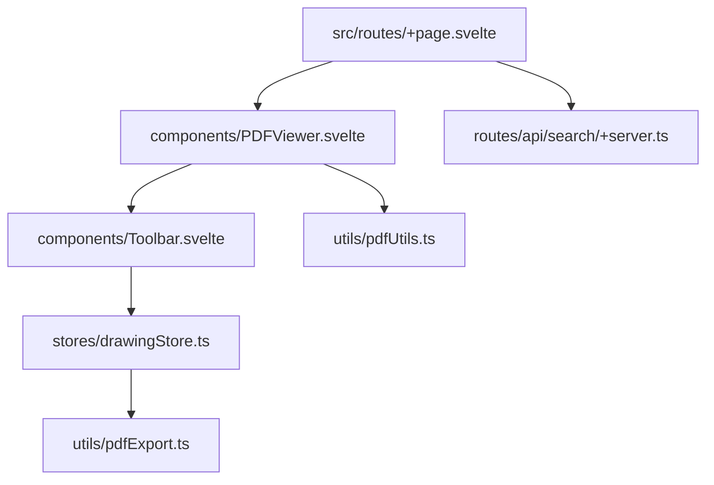

# rudi-q/leed_pdf_viewer

> SvelteKit web app to draw on and annotate PDFs in the browser, without uploading files.

## The problem
Annotating a PDF with a stylus or mouse often goes through a service that uploads the document.

## What it actually does
`PDFViewer` renders the document via PDF.js; the toolbar drives freehand drawing, shapes, text, notes, eraser; `drawingStore.ts` keeps the strokes and `pdfExport.ts` exports them. Local saving. A web PDF search goes through the Brave Search API. Tauri shell for the desktop.

## How it is wired


## Trying it
```bash
git clone https://github.com/rudi-q/leed_pdf_viewer.git
cd leed_pdf_viewer
pnpm install
pnpm build && pnpm preview
```

## Cost and gotchas
Node 18+. AGPL-3.0 license (modifications accessible over the network must be published), paid commercial licenses, paid Windows desktop app. Search requires a Brave key.

## What it is not
Not an editor of the PDF's text: a drawing tool on top.

## Alternatives
No alternative named in the README.

## For you
Ignore: a general-purpose PDF annotator, with license constraints that add nothing to your data / AI work.
