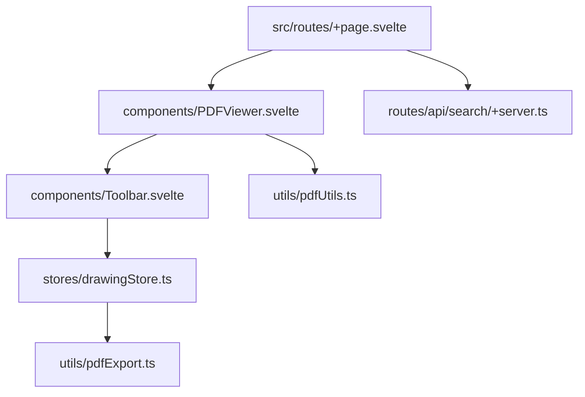

# rudi-q/leed_pdf_viewer

> Application web SvelteKit pour dessiner et annoter des PDF dans le navigateur, sans envoi de fichiers.

## Le problème
Annoter un PDF au stylet ou à la souris passe souvent par un service qui téléverse le document.

## Ce que ça fait vraiment
`PDFViewer` rend le document via PDF.js ; la barre d'outils pilote dessin libre, formes, texte, notes, gomme ; `drawingStore.ts` garde les tracés et `pdfExport.ts` les exporte. Sauvegarde locale. Une recherche de PDF sur le web passe par l'API Brave Search. Coque Tauri pour le bureau.

## Comment c'est branché


## Essayer
```bash
git clone https://github.com/rudi-q/leed_pdf_viewer.git
cd leed_pdf_viewer
pnpm install
pnpm build && pnpm preview
```

## Coût et pièges
Node 18+. Licence AGPL-3.0 (modifications accessibles par réseau à publier), licences commerciales payantes, application de bureau Windows payante. La recherche exige une clé Brave.

## Ce que ce n'est pas
Pas un éditeur du texte du PDF : un outil de dessin par-dessus.

## Alternatives
Aucune alternative nommée dans le README.

## Pour toi
Ignorer : annotateur de PDF généraliste, avec contraintes de licence qui n'apportent rien à ton travail data / IA.

