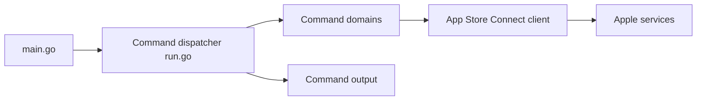

# rudrankriyam/App-Store-Connect-CLI

> Go CLI (`asc`) to automate iOS/macOS releases on App Store Connect from the terminal or CI.

## The problem
Publishing an app (builds, TestFlight, metadata, signing) through the web interface is manual and hard to script.

## What it actually does
Calls the App Store Connect API (plus Apple Ads and StoreKit): app listing, build upload, TestFlight groups, metadata, screenshots, pre-submission validation, signing. Outputs a table in a terminal and JSON when piped. Also installs 25 agent skills.

## How it is wired


## Trying it
```bash
brew install asc
asc auth login --name "MyApp" --key-id "ABC123" --issuer-id "DEF456" --private-key /path/to/AuthKey.p8 --network
asc apps list --output table
```

## Cost and gotchas
Apple API key (paid developer account). Pseudonymous telemetry is on by default: `asc telemetry disable` or `DO_NOT_TRACK=1`.

## What it is not
Not a general-purpose tool: reserved for the Apple ecosystem.

## Alternatives
No alternative named in the README.

## For you
Ignore for data/AI: useful only if you publish iOS apps.
