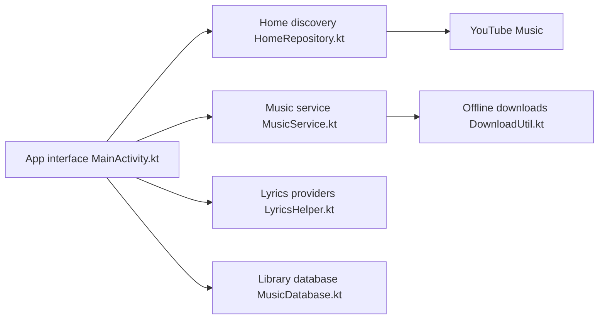

# rukamori/ArchiveTune

> Third-party Android client for YouTube Music, in Kotlin and Jetpack Compose, with lyrics and scrobbling.

## The problem
The official app imposes ads and few settings; some people want a customizable player.

## What it actually does
Android player with background playback, multiple accounts, EBU R128 normalization, crossfade, synchronized and translated lyrics (including by AI), music recognition, Spotify import, Last.fm, ListenBrainz and Discord. Highly configurable Material 3 interface.

## How it is wired


## Trying it
```bash
# Aucune commande dans le README : téléchargement via Obtainium, IzzyOnDroid
# ou les releases GitHub (liens listés).
```

## Cost and gotchas
Free. A VPN may be needed outside the covered regions. Forks are not supported. Depends on an unofficial YouTube Music API.

## What it is not
Not affiliated with Google or YouTube. Using it raises a risk with respect to YouTube's terms of service. Off-topic for a data/AI profile.

## Alternatives
Metrolist (the project's base) and SimpMusic, cited in the acknowledgments.

## For you
Ignore: consumer application unrelated to data, AI or MLOps, and GPL-3.0 copyleft if you wanted to reuse the code.
