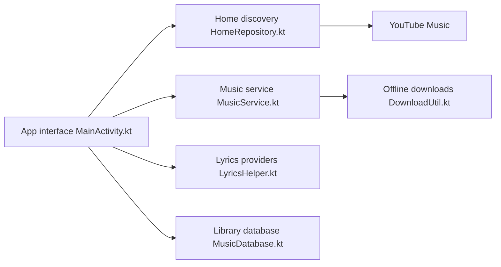

# rukamori/ArchiveTune

> Client Android tiers de YouTube Music, en Kotlin et Jetpack Compose, avec paroles et scrobbling.

## Le problème
L'application officielle impose publicités et peu de réglages ; certains veulent un lecteur personnalisable.

## Ce que ça fait vraiment
Lecteur Android avec lecture en arrière-plan, comptes multiples, normalisation EBU R128, fondu enchaîné, paroles synchronisées et traduites (y compris par IA), reconnaissance musicale, import Spotify, Last.fm, ListenBrainz et Discord. Interface Material 3 très configurable.

## Comment c'est branché


## Essayer
```bash
# Aucune commande dans le README : téléchargement via Obtainium, IzzyOnDroid
# ou les releases GitHub (liens listés).
```

## Coût et pièges
Gratuit. Un VPN peut être nécessaire hors des régions couvertes. Les forks ne sont pas supportés. Dépend d'une API non officielle de YouTube Music.

## Ce que ce n'est pas
Pas affilié à Google ni à YouTube. L'usage soulève un risque vis-à-vis des conditions de service de YouTube. Hors sujet pour un profil data/IA.

## Alternatives
Metrolist (base du projet) et SimpMusic, cités en remerciements.

## Pour toi
À ignorer : application grand public sans lien avec data, IA ou MLOps, et copyleft GPL-3.0 si tu voulais réutiliser le code.

