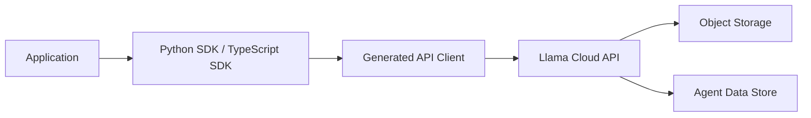

# run-llama/llama_cloud_services

> Python and TypeScript SDK, declared obsolete, for the LlamaIndex cloud APIs (parsing, extraction, index).

## The problem
The repository gave access to the LlamaIndex cloud services from an application. It is now replaced by new packages.

## What it actually does
The README contains only a deprecation notice (minimal sheet, insufficient material). It announces maintenance until May 1, 2026 and points to `llama-cloud>=1.0` (Python) and `@llamaindex/llama-cloud` (TypeScript). According to the code, the repository grouped clients for file upload, parsing, extraction, classification, index retrieval, spreadsheets and agent data.

## How it is wired


## Trying it
```bash
pip install llama-cloud>=1.0
npm install @llamaindex/llama-cloud
```
These commands install the replacement packages, the only commands in the README.

## Cost and gotchas
A Llama Cloud API key is required; pricing is not documented here. The announced end-of-maintenance date (May 1, 2026) has passed: the last push dates from May 18, 2026.

## What it is not
It is no longer the repository to follow: the notice asks to migrate. The catalog does not mark it as archived, but there is no reason to depend on it. It only works with the hosted service.

## Alternatives
- `llama-cloud` (Python): replacement package indicated by the README.
- `@llamaindex/llama-cloud` (TypeScript): same on the npm side.

## For you
Ignore: the README itself asks to migrate to the new packages, and this repository is no longer maintained.
