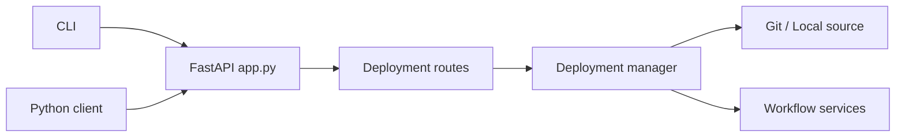

# run-llama/llama_deploy

> Deployment platform for LlamaIndex workflows, now obsolete and replaced by llama-agents.

## The problem
Serving agent workflows as services with tasks and sessions.

## What it actually does
The README boils down to one warning: the project is obsolete, use llama-agents. From the code: a FastAPI server with deployment and status routes, a manager that reads the config and fetches sources (Git or local), workflow services, a Python client, a CLI, metrics and tracing.

## How it is wired

## Trying it
No command documented in the README.

## Cost and gotchas
No cost of its own, but no maintenance should be expected: deprecated project.

## What it is not
Not a living project. Last push in April 2026.

## Alternatives
llama-agents: named in the README as the replacement.

## For you
Ignore: the project is declared obsolete by its publisher, go straight to llama-agents.
