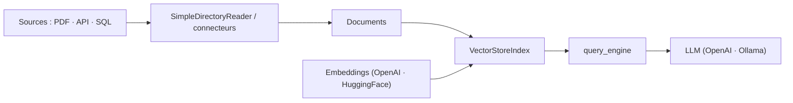

# run-llama/llama_index

> Open-source framework for agentic applications over private data: ingestion, indexing, querying.

## The problem
An LLM is trained on public data. Plugging in your own requires connectors, chunking, indexing and retrieval — otherwise recoded for every source.

## What it actually does
Provides data connectors (APIs, PDFs, documents, SQL), ways to structure that data into indexes and graphs, and a retrieval and query interface on top. Two entry points: `llama-index`, a starter package with a selection of integrations, or `llama-index-core` plus the integrations you choose from more than 300. The naming convention is explicit: an import containing `core` targets the core, without `core` it targets an integration.

## How it is wired


## Trying it
```bash
pip install llama-index-core
pip install llama-index-llms-openai
pip install llama-index-embeddings-huggingface
```

## Cost and gotchas
The library is free; LLM and embedding calls are at your expense (`OPENAI_API_KEY`), unless you go through Ollama and HuggingFace locally. By default data is held in memory: `index.storage_context.persist()` writes to disk. `llama-index-core` ships a `_static` folder (nltk and tiktoken caches), verifiable via `gh attestation verify`.

## What it is not
Beware of the direction signal: the README announces that the **company's main focus has shifted** toward LlamaParse, liteparse and benchmarks; the OSS framework remains available "as an open toolbox". LlamaParse, LlamaAgents, Extract and Index are separate products, requiring sign-up and an API key. The README is not updated as often as the documentation.

## Alternatives
- LangChain, Flask, Docker: cited as application frameworks to integrate with, not as substitutes.

## For you
Worth watching: still usable for RAG, but the shift of attention toward LlamaParse should be factored into your decision.
