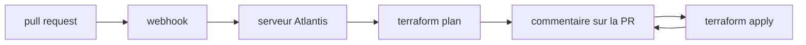

# runatlantis/atlantis

> Self-hosted Go application that runs Terraform from pull requests and comments the result.

## The problem
When every engineer runs `terraform apply` from their own machine, nobody sees the plan before it is applied and states drift apart.

## What it actually does
Listens to Terraform pull request events via webhooks.
Runs `terraform plan`, `import` and `apply` remotely.
Posts the output back as a comment on the pull request.
Makes Terraform changes visible to the whole team and standardizes the workflow.

## How it is wired

## Trying it
No installation command is documented in the README: it points to www.runatlantis.io/guide and to the GitHub releases.

## Cost and gotchas
Free. You have to host the server and give it access to the repository and to cloud credentials, which makes it a sensitive target. The README details neither the configuration nor the prerequisites.

## What it is not
Not a hosted service nor a replacement for Terraform Cloud: you operate the server yourself. The README is deliberately minimal and defers everything to the external documentation. It does not say which forges are supported.

## Alternatives
No alternative is named in the README.

## For you
Relevant only if you manage Terraform infrastructure as a team; otherwise off-topic for a data profile.
