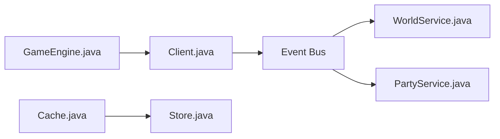

# runelite/runelite

> Open source client for the game OldSchool RuneScape with a plugin system, for players and developers.

## The problem
The official client offers neither overlays nor community extensions.

## What it actually does
Minimal README: three modules (cache, runelite-api, runelite-client). Judging from the architecture, the client exposes game state through the API and plugins produce overlays, player indicators, worlds, groups (party) and Discord presence; the cache library reads and writes the game files.

## How it is wired

## Trying it
The README says to open the project as a Gradle project in the IDE and run the RuneLite class of runelite-client. No command line documented.

## Cost and gotchas
Free. Prerequisites (JDK) not specified in the README, despite my inference of Java from the graph files.

## What it is not
Not a general-purpose tool: specific to one game.

## Alternatives
No alternative cited in the README.

## For you
Ignore: game client, outside the data / AI / MLOps profile.
