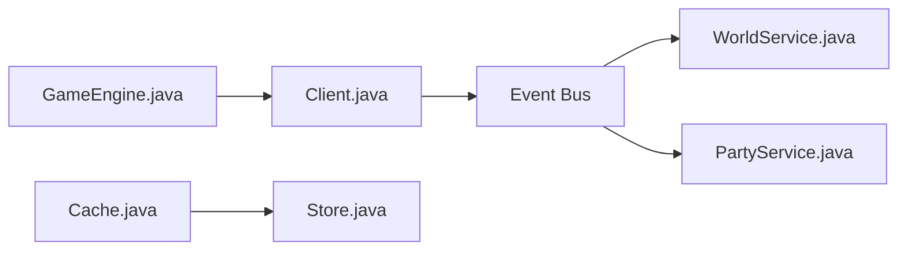

# runelite/runelite

> Client open source du jeu OldSchool RuneScape avec système de plugins, pour joueurs et développeurs.

## Le problème
Le client officiel n'offre ni overlays ni extensions communautaires.

## Ce que ça fait vraiment
README minimal : trois modules (cache, runelite-api, runelite-client). D'après l'architecture, le client expose l'état du jeu via l'API et des plugins produisent overlays, indicateurs de joueurs, mondes, groupes (party) et présence Discord ; la bibliothèque de cache lit et écrit les fichiers du jeu.

## Comment c'est branché

## Essayer
Le README dit d'ouvrir le projet comme projet Gradle dans l'IDE et d'exécuter la classe RuneLite de runelite-client. Aucune ligne de commande documentée.

## Coût et pièges
Gratuit. Prérequis (JDK) non précisés dans le README, malgré mon rapprochement Java via les fichiers du graphe.

## Ce que ce n'est pas
Pas un outil général : spécifique à un jeu.

## Alternatives
Aucune alternative citée dans le README.

## Pour toi
À ignorer : client de jeu, hors profil data / IA / MLOps.

