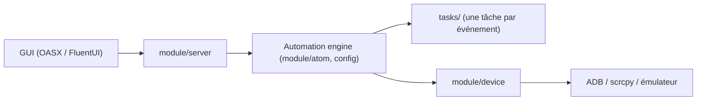

# runhey/OnmyojiAutoScript

> Automation bot for the daily tasks of the mobile game Onmyoji, derived from AzurLaneAutoScript.

## The problem
The game's repetitive tasks (daily, weekly, events) take time every day.

## What it actually does
Runs a long list of game tasks through image recognition and OCR (ppocr-onnx), with a task scheduler. Based on the architecture: a Python engine (atom, pydantic configuration), a device layer (ADB, scrcpy) and a separate graphical interface (FluentUI/QML, OASX in Flutter). An AI model handles one particular game mode. README in Chinese.

## How it is wired


## Trying it
```bash
# Aucune commande documentée dans le README : installation via les pages
# « Installation » et « Manuel » du site de documentation (liens non repris).
```

## Cost and gotchas
Free. An Android emulator or device is required (based on the architecture). Access to the QQ group is subject to account conditions. The authors ask not to advertise it, since players are hostile to scripts. Use may violate the game's rules (not documented).

## What it is not
Not a general-purpose UI automation tool. The README states it is provided without warranty, the authors disclaiming any responsibility.

## Alternatives
AzurLaneAutoScript (Alas), StarRailCopilot, MAA, FGO-py: neighboring projects listed, for other games.

## For you
Ignore: automation of one specific game, unrelated to data or AI.
