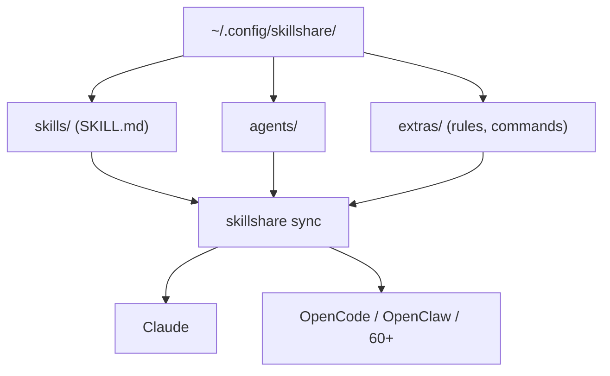

# runkids/skillshare

> A single source for the skills, agents and rules of all your AI CLIs, synced everywhere.

## The problem
Every AI CLI has its own skills directory. You edit in one, forget to copy to the other,
and no longer know what lives where.

## What it actually does
Keeps a source directory (`~/.config/skillshare/` on macOS/Linux, `%AppData%\skillshare\`
on Windows) containing `skills/`, `agents/` and `extras/`, then creates symbolic links (or
NTFS junctions on Windows, no admin rights needed) to more than 60 targets: Claude, Codex,
Cursor, OpenCode, OpenClaw… It also handles MCP connections defined once and translated into
each agent's native format, full plugins (skills + hooks + MCP settings), a prompt-injection
and exfiltration audit before installation, and fine-grained filtering through
`.skillignore`, the `targets` field of `SKILL.md` and per-target include/exclude rules.

## How it is wired


## Trying it
```bash
curl -fsSL https://raw.githubusercontent.com/runkids/skillshare/main/install.sh | sh
skillshare init            # Create config, source, and detected targets
skillshare sync            # Sync skills to all targets
skillshare audit
skillshare ui
```

## Cost and gotchas
Free, a single Go binary, no Node runtime, no registry, no telemetry, works offline. If symbolic
links cause trouble, switch a target to copy mode with `skillshare target <name> --mode copy`.

## What it is not
It is not a skills registry: it provides no content, it syncs yours. The security audit is a
scan, not a guarantee. The project moves fast (v0.21.0 announced in the README) and seems to be
carried by a single person.

## Alternatives
- Imperative per-command installers (compared in the README): simpler, but each skill is
  copied independently, with no source of truth.

## For you
Useful as soon as you juggle two or more agents and your skills start to diverge.
