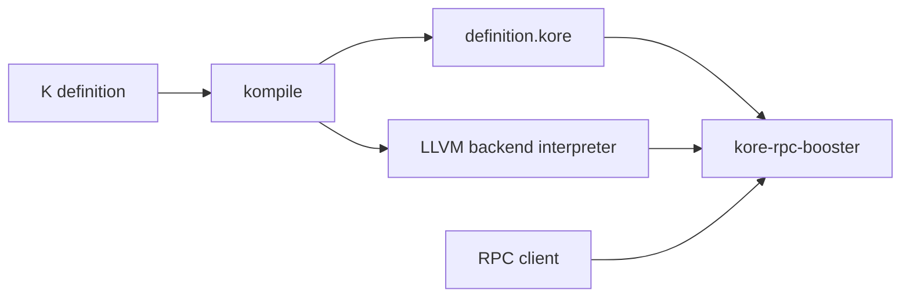

# runtimeverification/haskell-backend

> Haskell symbolic execution engine for the K Framework, aimed at formal verification developers.

## The problem
Formally verifying programs or smart contracts specified in K requires a symbolic rewriting engine.

## What it actually does
Symbolically executes programs of languages described in K, at the Kore IR level. The main executable `kore-rpc-booster` is a JSON RPC server; `kore-rpc` is the legacy version, `kore-exec` and `kore-repl` are deprecated. An optional LLVM backend simplifies boolean terms. The README states that this is not an end-user tool (see pyk).

## How it is wired


## Trying it
```bash
kompile --llvm-kompile-type c my_defintion.k
kore-rpc-booster ./my_defintion-kompiled/definition.kore --module MY-DEFINITION --llvm-backend-library ./my_defintion-kompiled/interpreter
stack build all   # ou : cabal build all
```

## Cost and gotchas
Free. Long Haskell build (Nix and binary caches recommended), K Framework must be installed, K version tied to deps/k_release. 158 open issues.

## What it is not
Not a ready-to-use prover: low-level layer. No link with ML.

## Alternatives
- pyk (in the K Framework repository) for the user-facing Python prover.

## For you
Ignore: niche formal verification, far from daily data / AI / MLOps work.
