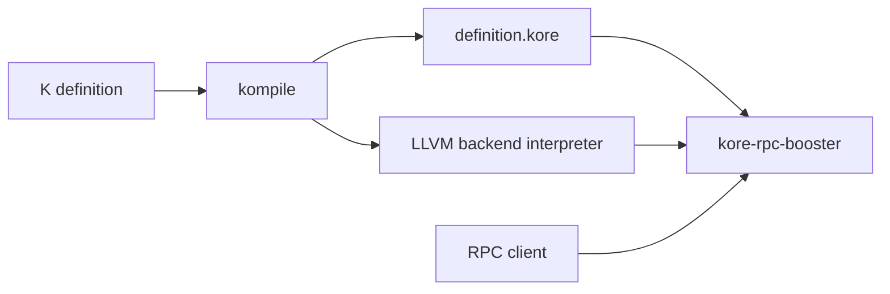

# runtimeverification/haskell-backend

> Moteur d'exécution symbolique Haskell pour le K Framework, destiné aux développeurs de vérification formelle.

## Le problème
Vérifier formellement des programmes ou smart contracts spécifiés en K demande un moteur de réécriture symbolique.

## Ce que ça fait vraiment
Exécute symboliquement des programmes de langages décrits en K, au niveau de l'IR Kore. L'exécutable principal `kore-rpc-booster` est un serveur JSON RPC ; `kore-rpc` est la version historique, `kore-exec` et `kore-repl` sont dépréciés. Un LLVM backend optionnel simplifie les termes booléens. Le README précise que ce n'est pas un outil pour utilisateur final (voir pyk).

## Comment c'est branché


## Essayer
```bash
kompile --llvm-kompile-type c my_defintion.k
kore-rpc-booster ./my_defintion-kompiled/definition.kore --module MY-DEFINITION --llvm-backend-library ./my_defintion-kompiled/interpreter
stack build all   # ou : cabal build all
```

## Coût et pièges
Gratuit. Compilation Haskell longue (Nix et caches binaires conseillés), K Framework à installer, version de K liée à deps/k_release. 158 issues ouvertes.

## Ce que ce n'est pas
Pas un prouveur prêt à l'emploi : couche basse. Aucun lien avec le ML.

## Alternatives
- pyk (dans le dépôt K Framework) pour le prouveur Python utilisateur.

## Pour toi
Ignorer : vérification formelle de niche, loin d'un quotidien data / IA / MLOps.

